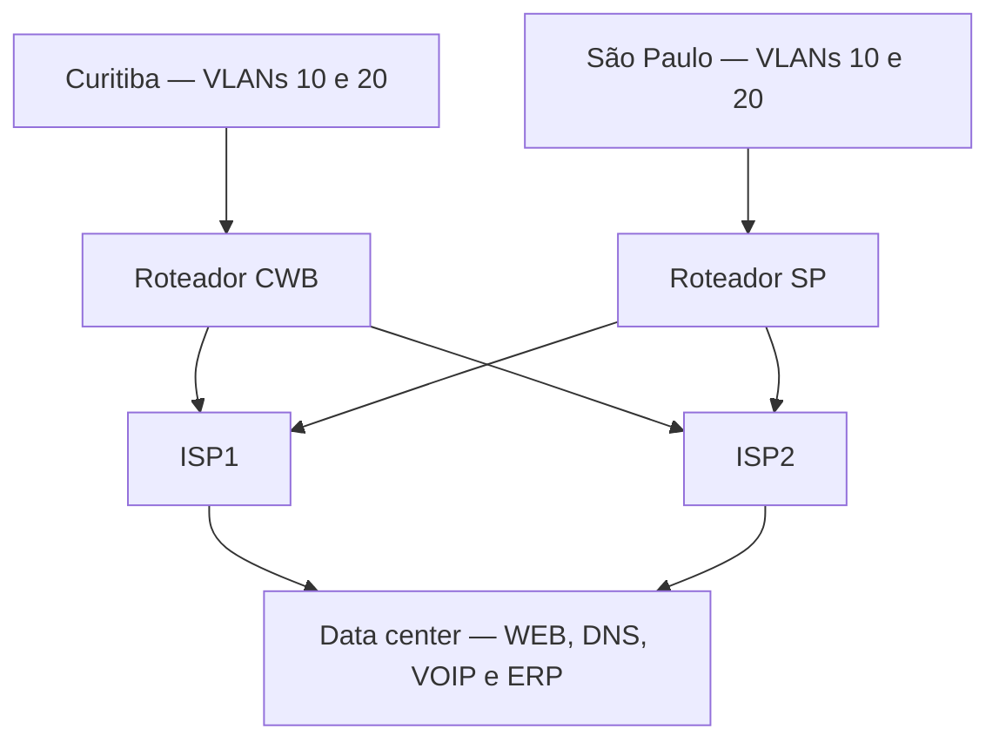

# Projeto de Rede Corporativa — Curitiba e São Paulo

Projeto acadêmico de redes de computadores desenvolvido no curso de **Ciência da Computação da PUCPR**, em 2026. A proposta conecta uma matriz em São Paulo e uma filial em Curitiba a um data center externo, com segmentação por departamentos, enlaces redundantes e tradução de endereços para acesso à rede pública simulada.

## Objetivo

Planejar e simular uma infraestrutura de rede corporativa, aplicando conceitos de topologia hierárquica, VLANs, endereçamento IPv4, conectividade entre redes e NAT/PAT.

## Visão geral

A topologia apresentada no relatório foi construída no **Cisco Packet Tracer** e contempla:

- Duas unidades: São Paulo (SP) e Curitiba (CWB).
- Organização em camadas de acesso, distribuição e núcleo.
- Duas VLANs por unidade: Operativo e Administrativo.
- Switches de camada 3 na distribuição e roteadores no núcleo.
- Enlaces com dois provedores de acesso: ISP1 e ISP2.
- Data center com servidores WEB, DNS, VOIP e ERP.
- NAT com sobrecarga (`overload`), também chamado de PAT/NAPT.

## Arquitetura

O diagrama abaixo resume as conexões entre as unidades, os provedores e o data center. Os equipamentos e enlaces internos estão detalhados no relatório.

## Segmentação e endereçamento

A **VLAN 10** atende o setor Operativo e a **VLAN 20** atende o setor Administrativo. Cada unidade utiliza sub-redes próprias.

Os valores abaixo seguem o diagrama da topologia e a seção de NAT do relatório:

| Unidade | Setor | VLAN | Sub-rede | Máscara | Gateway dos hosts |
| --- | --- | --- | --- | --- | --- |
| Curitiba | Operativo | 10 | `172.30.0.0/28` | `255.255.255.240` | `172.30.0.1` |
| Curitiba | Administrativo | 20 | `172.30.0.16/28` | `255.255.255.240` | `172.30.0.18` |
| São Paulo | Operativo | 10 | `172.30.0.32/28` | `255.255.255.240` | `172.30.0.33` |
| São Paulo | Administrativo | 20 | `172.30.0.48/28` | `255.255.255.240` | `172.30.0.50` |

Os enlaces entre os switches de distribuição e os roteadores utilizam sub-redes `/30`, conforme o diagrama:

| Unidade | Enlace | Sub-rede |
| --- | --- | --- |
| Curitiba | SW1 ↔ Roteador CWB | `172.30.0.80/30` |
| Curitiba | SW2 ↔ Roteador CWB | `172.30.0.84/30` |
| São Paulo | SW3 ↔ Roteador SP | `172.30.0.88/30` |
| São Paulo | SW4 ↔ Roteador SP | `172.30.0.92/30` |

## Data center

Os servidores utilizam máscara `255.255.255.224` (`/27`) e gateway `101.46.160.1`.

| Serviço | Endereço IP | Função prevista |
| --- | --- | --- |
| WEB | `101.46.160.2` | Hospedagem de aplicações web |
| VOIP | `101.46.160.3` | Comunicação de voz corporativa |
| DNS | `101.46.160.4` | Resolução de nomes |
| ERP | `101.46.160.5` | Sistema de gestão empresarial |

> Os endereços públicos apresentados fazem parte do cenário de simulação acadêmica.

## NAT/PAT

Segundo o relatório, os roteadores das duas unidades utilizam NAT com `overload` para permitir que múltiplos hosts privados compartilhem o endereço da interface de saída.

| Roteador | Redes internas atendidas | IP público utilizado |
| --- | --- | --- |
| CWB | `172.30.0.0/28` e `172.30.0.16/28` | `101.46.160.33` |
| SP | `172.30.0.32/28` e `172.30.0.48/28` | `101.46.160.41` |

As interfaces `GigabitEthernet0/0` e `GigabitEthernet0/1` foram definidas como `ip nat inside`. A tradução documentada utiliza a interface `GigabitEthernet0/3/0`, conectada ao ISP1.

## Como explorar o projeto

1. Consulte o relatório para visualizar a topologia completa e as tabelas de configuração.
2. Caso o repositório contenha o arquivo de simulação `.pkt`, abra-o no Cisco Packet Tracer.
3. Inspecione as VLANs, as interfaces dos equipamentos e as configurações de NAT.
4. Reproduza o teste de conectividade ao servidor WEB (`101.46.160.2`) descrito no relatório.

## Validação documentada

O relatório registra a realização de testes de `ping` ao endereço externo `101.46.160.2` para validar a conectividade utilizada na configuração de NAT.

A topologia prevê enlaces redundantes. O documento não detalha o protocolo de roteamento adotado nem apresenta testes de failover ou de funcionamento de cada serviço do data center.

## Observações sobre a documentação

O relatório contém divergências entre a tabela intitulada **“Endereços IPs — VLANs”**, a tabela de enlaces internos e os endereços apresentados no diagrama e na seção de NAT. Este README adota os valores do diagrama e da seção de NAT; a configuração efetiva deve ser conferida no arquivo `.pkt`.

## Autores

- Geovana Estrela
- Thiago Muraro
- Heitor dos Santos
- Richard Maximilian

**Instituição:** Pontifícia Universidade Católica do Paraná (PUCPR)  
**Curso:** Ciência da Computação  
**Ano:** 2026

